  

  
  
  

 

  
  

  

<h3 align="center">⚡ Selected Work</h3>

| | Project | In one line | Proof |
| :---: | :--- | :--- | :--- |
| 🔎 | [**FlashFind-Vi**](https://github.com/votranngochuu/FlashFind-Vi) · *research lead* | On-device Vietnamese OCR search | `2.5× QPS` · `p95 < 500 ms` · `−30–40% RAM` |
| 🧩 | **MC-DP** · *first-author paper* | Split inference that never runs out of memory | `100% feasible` vs `20% OOM` baseline |
| 📄 | **Anything2MD** · *FPT Software* | Any document → RAG-ready Markdown | `cost-gated AI` · `zero-egress mode` |
| 🏅 | [**Member Ranking**](https://github.com/votranngochuu/member-ranking-management) · *GDGoC* | Club leaderboard with a Gemini agent | `function calling` · `JWT` · `Supabase` |
| 🚲 | [**VeloX**](https://github.com/votranngochuu/sport-bike-exchange-be) · [*live*](https://sport-bike-exchange-fe.vercel.app) | Bike marketplace back-end | `Java 21` · `Spring Security` · `RBAC` |

<h3 align="center">🧰 Stack</h3>

  

<h3 align="center">📈 Activity</h3>

  
  

  <picture>
    <source media="(prefers-color-scheme: dark)" srcset="https://raw.githubusercontent.com/votranngochuu/votranngochuu/output/github-snake-dark.svg" />
    <source media="(prefers-color-scheme: light)" srcset="https://raw.githubusercontent.com/votranngochuu/votranngochuu/output/github-snake.svg" />
    
  </picture>

<i>Systems scale code. Communities scale people.</i>

